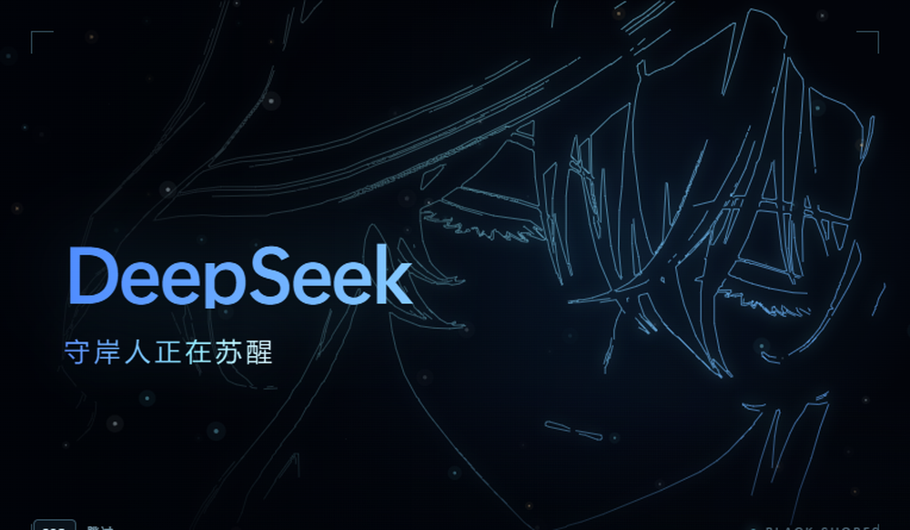

# 守岸人挂件 · dsh-shorekeeper-widget

> 在 DeepSeek Harness（DSH）界面右下角常驻一只「守岸人」：看余额、记今日花了多少、每轮对话花了多少，
> 点一下会冒出你自定义的泡泡，开机还会播一段过场动画。

本项目是 [dsh-whale-widget](https://github.com/MeteorNOX/DeepSeek-Balance-Whale-Widget) 的**独立衍生项目**：
包名、路由、数据前缀、资源目录全部独立，可以和上游同时安装而互不覆盖；功能上保留上游全部能力，
并新增了**启动动画**、**备份与迁移**、**旧数据自动迁移**。



- 许可证：代码 MIT；素材见 [PROVENANCE.md](PROVENANCE.md)
- 当前版本：**1.2.0**（见 [CHANGELOG.md](CHANGELOG.md)）

---

## 一、功能一览

### 记账与显示

- **余额**：自动刷新 + 点角色手动刷新，变化带滚动动画。取数方式二选一：DSH 凭据里的 `DEEPSEEK_API_KEY`，
  或「设置 → 账号与余额」登录后的账号登录态（不需要单独建 key）。
- **今日已用**：不需要令牌。余额下降按观测累计为消费，充值/赠金单独记录，不会冲掉已有消费；
  逐轮明细保留 90 天（或最多 2 万条）、逐日归档保留 365 天。
- **每轮对话消耗**：监听本机会话的真实 usage（input / cache / output / reasoning），按模型峰谷价换算金额，
  每轮结束弹泡泡；内容、自动关闭秒数、提示音都可改。
- **峰谷定价**：工作日 9:00–12:00、14:00–18:00 为高峰（北京时间），其余空闲；2026-08-23 起周末全天谷价。
- **用量记录**：今日 / 近 7 天 / 全部；模型占比条；按日期展开逐条明细，支持按日期或模型名搜索。

### 泡泡系统

- 点击序列：首次点击泡 + 再次点击队列，可增删排序，可把两泡**并列加权**（每轮抽一个）。
- 模块化：文本、超链接、随机语句（带权重、不连续重复）、图片 / 随机图片、总余额 / 赠金 / 充值余额 /
  今日已用 / 峰谷时段 / 对话名。
- 逐模块样式：字体、字号、粗斜体、下划线、纯色或跑马灯渐变、底色。
- 拖拽排版：桌面原生拖拽、移动端长按拖拽；每行最多 6 个模块、泡泡最多 6 行。

### 提醒与音效

- 余额预警、今日预算、每轮消耗提示，三类提醒内容都可编辑（含图片 / 随机图片）。
- 按压 / 松开音效、任务结束音、提问提示音、授权提示音；内置音效组 + 可导入音频片段自由组合。
- 自定义角色立绘、泡泡图库；隐藏菜单按钮（电脑右键 / 手机长按唤出）。

### 多厂商余额与额度

- 34 个厂商模板（DeepSeek、OpenRouter、Kimi、智谱、MiniMax、OpenCode Go、OneAPI 中转站等），
  选完自动带好接口地址、字段路径与探活地址；模板只给默认值，可随意改写。
- 密钥写进 DSH 官方凭据服务，配置文件里**只存凭据名**。
- 订阅额度支持一个接口多窗口（如 5h / 周 / 月），逐窗口展示已用百分比与重置倒计时。

### 1.2.0 新增：完整启动编排

**🎬 守岸人睁眼（与「守岸人主题」插件同款编排）**

打开 DSH 主界面时播放的是一整套编舞，不只是视频：

1. **逐笔线稿**：443 条矢量笔画按「结构 → 中景 → 细节」分三批生长（`stroke-dashoffset`），衬黑底星尘
2. **文字入场**：`DeepSeek` 与「守岸人正在苏醒」自下而上渐显
3. **睁眼融合**（3.83s）：闪光 + 下扫光 + 46 颗粒子爆发，线稿淡出、影片亮起
4. **逐字推入**：「欢迎回来，漂泊者」每个字带位移与去模糊，沿整行取蓝色渐变
5. **标识拼装**：黑海岸标识拆成 24 个部件自右向左推入，`BLACK SHORES` 最后淡入
6. **退场**：画面采样成数千彩色光点，先向外扩散再向中心汇聚，最后整层淡出

- 播放速度 1.25×，与主题插件一致；点击 / `Esc` / 跳过按钮立即结束
- 影片两档：`1600×900 / 60fps`（3.2 MB）与 `1280×720 / 30fps`（1.7 MB），`auto` 按设备能力选档
- 线稿与标识数据（52 KB）由宿主路由下发，只在播放时拉取，不占首屏
- `prefers-reduced-motion`：关闭笔画生长与位移动画
- 检测到「守岸人主题」插件时**主动让位**，不会两段动画叠着播
- 入口：菜单 →「启动动画」（开关），右侧「设置」里选画质、开关文字、预览


### 1.2.1 修复：打开时的两处观感

- **不再先闪一下主页面**：宿主在 `<head>` 里内联一段最早执行的脚本先盖黑幕，挂件判定完成后
  接管或撤掉它（关掉启动动画的用户不盖）。实测黑幕在 7ms 出现、动画 190ms 接管。
- **退场不再硬切**：粒子散尽后用 0.9 秒把界面渐显出来；点「跳过」是 0.38 秒淡出。
  之前那版因为 CSS `animation ... both` 一直占着 `opacity`，淡出整条被覆盖。

### 1.1.0 已有：影片资源

影片本体（`startup-hd.mp4` / `startup-sd.mp4` / 首帧海报）走独立路由，支持 HTTP Range 与长缓存；
调度、海报兜底、解码器释放等机制沿用 1.1.0。

### 1.0.0 已有

**💾 备份与迁移**
菜单 →「备份与迁移」→「导出」得到一个 JSON（外观开关 + 泡泡 + 模型表 + 账本），
换电脑后「导入」即可原样恢复。

- 导出内容**不含任何密钥**，模型表里只有凭据名
- 导入前自动在数据目录留 `*.before-import` 备份，导错了可以手工回滚

**🔁 旧数据自动迁移**
首次启动时若检测到上游 `dsh-whale-widget` 的数据（`.dshw-*`、`whale-roles` / `whale-audio` / `whale-bubble-imgs`），
会自动**复制**到新前缀下；不删旧文件，也不覆盖已有的新数据。

---

## 二、安装

> 仓库是**公开**的，所以 `dsh web` 可以直接从 GitHub 装；桌面客户端因为 profile 由 Electron 独占，
> 走「下载发布包 → Plugins → Add plugin」这条路。

| 形态 | profile | 怎么装 |
|---|---|---|
| 官方**桌面客户端**（Electron） | `desktop` | **只能**用客户端内的插件页 / `plugin_manager`，命令行装不进去 |
| `dsh web` / CLI | `web` | `dsh plugin --profile web add github:XXTZ-fia/dsh-shorekeeper-widget` |

### 快速安装（`dsh web` / CLI）

```powershell
dsh plugin --profile web add github:XXTZ-fia/dsh-shorekeeper-widget
```

装完重启 `dsh web`，浏览器 `Ctrl+F5`。就这一步，不需要先 clone。
（需要本机能访问 GitHub；有代理时先设 `HTTPS_PROXY` / `HTTP_PROXY`。）

### A. 官方桌面客户端（推荐路径）

桌面端的 `desktop` profile 由 Electron 应用独占管理，`dsh plugin --profile desktop` 会被**拒绝**执行
（`profile "desktop" is managed exclusively by the Electron application`）。正确做法有两种：

**A1. 在客户端界面里装**

1. 到 [Releases](https://github.com/XXTZ-fia/dsh-shorekeeper-widget/releases/latest) 下载
   `dsh-shorekeeper-widget-v1.2.0.zip`，解压到一个**以后不会移动或删除**的目录
   （例如 `D:\Plugins\dsh-shorekeeper-widget`）。要安装的是「包含 `package.json` 的那一层」，
   不要多套一层同名目录。也可以直接 `git clone` 仓库，效果一样。
2. 打开 DSH 桌面客户端 → 左侧 **Plugins（插件）** → **Add plugin（添加插件）** → 选择上面的目录。
3. 装完**完全退出**客户端（含系统托盘）再重新打开。

**A2. 让会话里的 AI 帮你装**

在 DSH 会话里说：

> 请用当前桌面端内置的 `plugin_manager`，把本地目录 `D:\Plugins\dsh-shorekeeper-widget`（`install_bundle`）
> 安装到当前 profile。先核对当前 profile 和是否已有同名插件，完成后告诉我安装结果、是否需要重启。

### B. Web / CLI（`dsh web`）

```powershell
# 直接从 GitHub 装（推荐）
dsh plugin --profile web add github:XXTZ-fia/dsh-shorekeeper-widget

# 或先下载发布包解压到固定目录，再用本地目录装（离线 / 代理不稳时用这个）
dsh plugin --profile web add link:D:\Plugins\dsh-shorekeeper-widget

# 已发布到 npm 时
dsh plugin --profile web add dsh-shorekeeper-widget
```

装完**重启 `dsh web`**，浏览器 `Ctrl+F5` 强制刷新。

> `dsh plugin` 会把参数转给 pnpm。`github:` 安装需要本机有 `git` 且能访问 GitHub；
> 需要代理时先设 `HTTPS_PROXY` / `HTTP_PROXY`。`link:` 安装后**不能移动该目录**，移动了要重新 add 一次。

### C. 安装脚本（Windows）

```powershell
# 自动识别形态并给出可执行步骤（不会擅自改 profile）
powershell -ExecutionPolicy Bypass -File .\install.ps1

# 指定形态 / 来源
powershell -ExecutionPolicy Bypass -File .\install.ps1 -Mode web -Source github
powershell -ExecutionPolicy Bypass -File .\install.ps1 -Mode desktop -Path "D:\Plugins\dsh-shorekeeper-widget"
```

脚本只做三件事：检查包是否完整、按形态给出安装命令或界面步骤、验证装完的关键文件。

### D. 升级 / 卸载

```powershell
# Web / CLI
dsh plugin --profile web add github:XXTZ-fia/dsh-shorekeeper-widget   # 升级到最新
dsh plugin --profile web remove dsh-shorekeeper-widget                # 卸载

# 桌面端
# 在插件页里对 dsh-shorekeeper-widget 操作升级 / 移除；升级后完全退出重开
```

用户数据（账本、泡泡、角色、音效）都在 `%USERPROFILE%\.dsh` 下，**卸载插件不会删数据**；
需要彻底清理时手动删除下表中的文件与目录。

### E. 装完怎么验证

1. **宿主半区**：`%USERPROFILE%\.dsh\.skdw-turn.json` 会随对话出现并递增 `seq`。
2. **客户端半区**：刷新页面，右下角出现守岸人；打开浏览器 DevTools → Application → Local Storage，
   能看到 `skdw-pos` / `skdw-last-seq`。
3. **接口**：浏览器访问 `http://127.0.0.1:<你的端口>/dsh-shorekeeper/size.json` 应返回 JSON。
4. 菜单底部能看到版本号 `v1.2.0`。

---

## 三、首次使用

### 凭据

- **只想要余额**：在 DSH「设置 → 模型」里配好 DeepSeek API key，或在「设置 → 账号与余额」登录 DeepSeek 账号。
- **密钥不落配置**：本插件从不把 key 写进自己的 JSON；写进 DSH 官方凭据服务，配置里只存凭据名。
- 余额预警、今日预算、每轮消耗提示的开关都在菜单里；记账与模型配置在「守岸人记账」子菜单。

### 启动动画

菜单 →「启动动画」：

- 左侧 `[✓]` 是总开关
- 右侧「设置」里可以选画质（自动 / 高清 60fps / 流畅 720p）、开关两行文字、点「预览」立刻播一次
- 想再看一次：刷新页面即可（同一标签页只播一次）
- 如果你还装着「守岸人主题」插件，挂件会自动让位，不会出现两段动画叠在一起

### 备份与迁移

菜单 →「备份与迁移」：

- **导出**：下载 `shorekeeper-backup-YYYYMMDD-HHmm.json`
- **导入**：选文件 → 服务端写入并留 `*.before-import` 备份 → 页面自动刷新

---

## 四、数据文件

都在 `%USERPROFILE%\.dsh`（即 `$DSH_HOME`）下：

| 路径 | 内容 |
|---|---|
| `.skdw-size.json` | 外观与开关（大小、音效、启动动画、避让等） |
| `.skdw-usage.json` | 记账账本（逐轮明细 + 逐日汇总） |
| `.skdw-usage-archive.json` | 超期归档 |
| `.skdw-api.json` | 模型注册表（只存凭据名） |
| `.skdw-bubble.json` | 泡泡配置 |
| `.skdw-turn.json` | 每轮消耗的序号 |
| `shorekeeper-roles/` | 自定义角色图 + `roles.json` |
| `shorekeeper-audio/` | 音频片段 + `audio.json` |
| `shorekeeper-bubble-imgs/` | 泡泡图库 + `bubble-imgs.json` |

排障时按这个表核对即可；接口地址都在 `/dsh-shorekeeper/*` 下（如 `size.json`、`about.json`、`export.json`）。

### 与上游共存

- 本插件数据前缀是 `.skdw-*` / `shorekeeper-*`，上游是 `.dshw-*` / `whale-*`，**不会互相覆盖**。
- 两者可以同时安装；浏览器端全局标记、CSS 类名也不同（`skdw*` / `skdwv*`），不会抢同一个挂件。
- 首次启动会把上游数据复制过来（见上文「旧数据自动迁移」），之后各写各的。

---

## 五、开发

```powershell
npm run check     # 语法 + 清单一致性 + 路由 + 资源引用 + 残留品牌词
npm run smoke     # 宿主半区冒烟：用临时 DSH_HOME 实跑配置读写 / 导出导入 / 旧数据迁移
npm run mock      # 起一个本地 mock 宿主，浏览器直接看挂件（不用装 DSH）
npm run pack      # 生成 dist/dsh-shorekeeper-widget-v1.2.0.zip
```

`npm run mock` 会在 `http://127.0.0.1:8791` 起一个只监听回环的假宿主，页面里放了一个模拟 composer
（挂件只在主聊天界面初始化），接口全是本地桩数据。调 UI 时刷新即可；页面左下角会显示运行时 JS 报错。

```powershell
node tools/mock-host.mjs --port 9000 --scale 1.2 --intro 3000 --style starlit --menu
```

目录结构：

```
lib/index.js                 宿主插件（路由 / 余额 / 记账 / 配置 / 导出导入）
lib/accounting.mjs           记账纯函数（金额精度、按日汇总、对账）
assets/shorekeeper-widget.js 浏览器端挂件（IIFE，注入到 DSH 页面）
assets/*.png|gif|wav|mp3     立绘、泡泡图、音效
cordis.patch.yml             bundle 挂载声明
tools/check.mjs              自检
tools/pack-release.mjs       打包
install.ps1                  安装助手
```

改浏览器端后不用重启 DSH，**硬刷新页面**即可（宿主按 mtime 重读文件）；改宿主端需要重启所在的 DSH 进程。

---

## 六、常见问题

**装完右下角什么都没有？**
先确认装到了哪个 profile：桌面端读 `desktop`，`dsh web` 读 `web`。再看 `%USERPROFILE%\.dsh\profiles\<profile>\package.json`
的 `dsh.profile.bundles` 里有没有 `dsh-shorekeeper-widget`。桌面端首装后需要完全退出再打开。

**启动动画不播？**
菜单里「启动动画」的勾要打上；同一标签页只播一次，刷新试试。若装了「守岸人主题」插件，挂件会主动让位（这是预期行为）。系统开了「减少动态效果」时只显示海报 1.6 秒，且不会下载视频。

**余额一直是「—」？**
说明没取到数：检查 DSH 凭据里有没有 `DEEPSEEK_API_KEY`，或是否登录了 DeepSeek 账号。
点一下角色可手动重试，菜单 →「关于 / 自检」里有失败原因。

**导入备份后设置没变？**
导入会写服务端并自动刷新页面；若页面没刷新，手动 `Ctrl+F5`。导入前的旧文件在数据目录的 `*.before-import`。

**和上游插件一起装会冲突吗？**
不会。数据前缀、路由、CSS 类名都不同，两个挂件会各自出现在右下角（位置可能重叠，拖动即可分开）。

---

## 七、致谢与许可

- 上游项目：[MeteorNOX/DeepSeek-Balance-Whale-Widget](https://github.com/MeteorNOX/DeepSeek-Balance-Whale-Widget)（MIT），
  本项目的宿主与浏览器端代码基于其 0.4.2 移植，其版权声明保留在 `LICENSE` 中。
- 代码：MIT。素材：不适用 MIT，详见 [PROVENANCE.md](PROVENANCE.md)。
- 「守岸人」角色形象版权归库洛游戏（Kuro Games），本项目仅为个人非商业的界面装饰用途，与官方无关。
